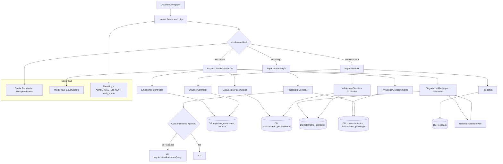

# Arquitectura del sistema S-Emotion

## Resumen de arquitectura

S-Emotion sigue una arquitectura **MVC** propia de Laravel 11, organizada por dominios funcionales con separación clara de responsabilidades:

- **Presentación**: Vistas Blade (`resources/views/`) + assets Vite (`resources/js/css`).
- **Controladores**: Lógica de aplicación agrupada por módulos (`app/Http/Controllers/`).
- **Modelo/Dominio**: Eloquent Models + Enums (`app/Models/`, `app/Enums/`).
- **Servicios**: Lógica reutilizable (`app/Services/RandomForestService.php`).
- **Autorización**: Spatie Laravel Permission (`roles` + `permissions`) + middleware personalizado `EsEstudiante`.
- **Datos**: Migraciones, seeders, factories (`database/`).

El sistema se divide conceptualmente en tres espacios con puertas de acceso distintas:

1. **Espacio de autoobservación (Estudiante)** – `/dashboard`, `/historial`, `/evaluacion-psicometrica`, `/perfil/calendario`, `/terminal/minijuegos/*`, `/mi-privacidad`. Protegido por middleware `estudiante`.
2. **Espacio de atención (Psicólogo)** – `/psicologia/*`. Requiere rol `Psicólogo` y acceso únicamente a estudiantes con **consentimiento vigente** (filtrado por `Consentimiento::vigentes()` + verificación `abort_unless`).
3. **Espacio de gestión (Administrador)** – `/usuarios/*`, `/admin/feedback`, `/admin/validacion-cientifica`. Requiere rol `Administrador`. El panel de validación científica es **agregado** (sin cargar `user`) y el administrador no accede a datos clínicos individuales salvo por la misma vía de consentimiento (no hay atajo).

## Diagrama de arquitectura general

## Módulos principales

| Módulo | Descripción | Archivos clave |
|---|---|---|
| Autenticación/Registro | Login por `correo`+`password`, selección de tipo de cuenta (Estudiante/Psicólogo/Administrador), validación `ADMIN_MASTER_KEY` para roles no-estudiante, asignación de rol (`rol` + Spatie), redirección por `rutaDeInicio()`. | `AuthController`, `User` (`tiposDeCuenta`, `esEstudiante/esProfesional/esAdmin`, `rutaDeInicio`), `config/auth.php`, `lang/es/validation.php` |
| Autoobservación (emociones) | Registro diario con emoción/energía/contexto/observaciones, motor de análisis neural (léxico+contexto+serie temporal) que calcula `nivel_estres_estimado`, `recomendacion`, `alerta_burnout`. Historial, calendario (heatmap agrupado por día en PHP), PDF reporte. | `EmocionController`, `RegistroEmocion`, vistas `dashboard`, `historial`, `perfil/calendario`, `reportes/emociones` |
| Psicometría (SISCO) | Creación/almacenamiento de `evaluaciones_psicometricas` (instrumento, puntajes por dimensión, `nivel_estres` enum, `estado_afectivo_predominante`, `respuestas_detalle` JSON). Etiquetado centralizado en modelo (`nivelEstresEtiqueta`, `estadoAfectivoEtiqueta`). | `EvaluacionPsicometricaController`, `EvaluacionPsicometrica`, `EmocionEnum` |
| Minijuego + Telemetría + IA | "Código Anómalo": recolección de métricas conductuales (`latencia_promedio_ms`, `frecuencia_tapping`, `tiempo_total_ms`, `conteo_rectificaciones`, `errores_diagnostico`, `score_final`, emoción objetivo/predicha, correcto, `vector_caracteristicas` JSON). Inferencia con `RandomForestService` (5 árboles heurísticos) que devuelve predicción + confianza + probabilidades. | `DiagnosticoController`, `TelemetriaGameplay`, `RandomForestService`, `EmocionEnum` |
| Privacidad/Consentimiento | Flujo iniciado por estudiante: canjea código de invitación (único, legible, sin I/O/0/1/L/S), elige alcance (`registros`, `evaluaciones`, `juego`), crea/actualiza consentimiento vigente (reconexión actualiza alcance, no duplica), revocación inmediata (`revocado_en`), histórico auditable. | `PrivacidadController`, `Consentimiento`, `InvitacionPsicologo`, `AlcanceConsentimiento` |
| Psicología (atención) | Listado de pacientes con consentimiento vigente (`vigentes()->deProfesional()`), ficha filtrada por `incluye(alcance)` (solo carga bloques autorizados), generación/anulación de códigos de invitación (orden por `created_at`, pertenencia obligatoria). | `PsicologiaController`, vistas `psicologia/*` |
| Administración | Gestión usuarios (index/destroy, cambio rol), feedback, validación científica (agregada). | `UsuarioController`, `ValidacionCientificaController` |
| Roles/Permisos | Seed de roles `estudiante`, `Psicólogo`, `Administrador` con permisos granulares; middleware `role:Psicólogo`/`role:Administrador`; middleware `estudiante` personalizado. | `RoleSeeder`, `bootstrap/app.php`, `User` helpers |

## Decisiones técnicas relevantes

| Decisión | Razón | Implementación |
|---|---|---|
| Separación rol clínico vs admin | Evitar que "administrar sistema" permita acceder a datos clínicos. | `User::esProfesional()` solo `Psicólogo`; rutas `/psicologia/*` con `role:Psicólogo`; panel validación sin carga de `user`. |
| Espacio autoobservación reservado | Evitar acceso cruzado; enlaces ocultos no bastan. | Middleware `EsEstudiante` (`app/Http/Middleware/EsEstudiante.php`) + alias `estudiante`. |
| Consentimiento vigente obligatorio | Principio "sin consentimiento vigente, no hay datos". | `Consentimiento::scopeVigentes()`, `estaVigente()`, `abort_unless` en `PsicologiaController@paciente`, filtrado en listado. |
| Alcance granular (JSON) | Compartir registros sin ceder evaluaciones completas; control preciso. | `consentimientos.alcance` JSON + `AlcanceConsentimiento` enum + `incluye()`. |
| Código de invitación, no directorio | Consentimiento explícito voluntario, sin exponer profesionales/estudiantes. | `invitaciones_psicologo` (código 8 chars alfabeto sin ambiguos I,O,0,1,L,S), `buscarVigente()`, único. |
| Reconexión actualiza alcance | "Lo que comparto ahora" es una respuesta, no historial de eventos. | `Consentimiento::vigenteEntre()` + update en lugar de crear nuevo (mantiene trazabilidad histórica vía revocaciones). |
| Revocación sin borrar | Evidencia auditable (quién/cuándo/hasta cuándo/motivo). | `revocado_en` nullable, `motivo_revocacion`, `scopeVigentes()`, histórico separado. |
| Código anónimo (HMAC) | Agrupar sesiones sin exponer id de usuario. | `User::codigoParticipante($id)` = `TESVB-` + 8 hex primeros HMAC-SHA256(`participante:$id`, `APP_KEY`); usado en export CSV de validación. |
| Validación científica agregada | Privacidad: métricas poblacionales, sin datos individuales. | `ValidacionCientificaController` **no** `with('user')`, solo agregados + conteos + matriz por clases RF; export CSV sin cargar usuarios. |
| Random Forest heurístico | Inferencia local, determinista por reglas (5 árboles) con softmax para probabilidades/confianza. | `RandomForestService::predecir()` (votos ponderados + `calcularProbabilidades`), vectores validados con topes razonables. |
| Etiquetado centralizado | Consistencia UI + traducción/normalización. | `EmocionEnum::etiqueta/normalizarParaRF/mapaColapso/validacion/juego`, modelos con helpers `nivelEstresEtiqueta()`, `estadoAfectivoEtiqueta()`. |
| Agrupado calendario en PHP | Evitar desfase TZ/portabilidad DATE() GROUP BY. | `groupBy(fn($r)=>$r->created_at->format('Y-m-d'))` sobre colección (Laravel). |
| Validación ES + throttling | UX clara y mitigación abuso. | `lang/es/validation.php`, rutas con `throttle:10,1` (login), `20,1` (registro), `60,1` (telemetría). |
| ADMIN_MASTER_KEY con hash_equals | Comparación segura contra temporización. | `AuthController@register` lee `config('auth.admin_master_key')`/`app.admin_master_key`, compara con `hash_equals`. |

## Patrones observados

- **Policy by construction**: verificaciones explícitas (`abort_unless`, scopes) en controladores sensibles (psicología), no solo middleware.
- **Fail closed**: si falta consentimiento -> 403; si tipo declarado no coincide con cuenta -> logout + error.
- **Defensive validation**: topes numéricos en telemetría (guardas), `in:` con enums/valores, normalización (`strtoupper/trim/lowercase`).
- **Single source of truth para etiquetas**: `EmocionEnum` centraliza traducción/colapso entre taxonomías (juego 8 clases vs RF 5).
- **No mass assignment de privilegios**: `rol` no está en `$fillable` de User; asignado explícitamente + `assignRole` si existe.