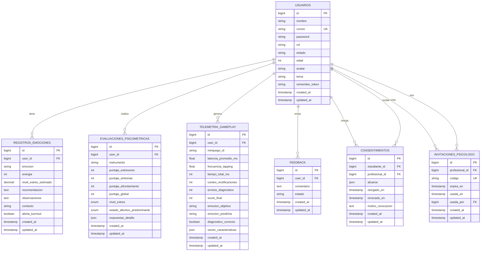

# Base de datos: modelo, entidades y ER

## Visión general

Base de datos relacional (Laravel migrations). Entidades principales: `usuarios`, `registros_emociones`, `evaluaciones_psicometricas`, `telemetria_gameplay`, `consentimientos`, `invitaciones_psicologo`, `feedback`, además tablas de Spatie Permission (`roles`, `permissions`, `model_has_roles`, `model_has_permissions`, `role_has_permissions`) y soporte Laravel (`sessions`, `cache`, `jobs`, `job_batches`).

Convenciones: tabla `usuarios` (no `users`), timestamps `created_at/updated_at`, FKs con `onDelete('cascade')`/`nullOnDelete()` según dominio. Campos con sufijo `_en` marcan hitos (otorgado_en, revocado_en, expira_en, usada_en). `alcance` es JSON. `respuestas_detalle` y `vector_caracteristicas` JSON.

## Modelos y relaciones

| Modelo | Tabla | Relación | Destino |
|---|---|---|---|
| `User` | `usuarios` | `hasMany` emociones | `RegistroEmocion` (user_id) |
|  |  | `hasMany` evaluacionesPsicometricas | `EvaluacionPsicometrica` (user_id) |
|  |  | `hasMany` telemetriasGameplay | `TelemetriaGameplay` (user_id) |
|  |  | `hasMany` feedbacks | `Feedback` (user_id) |
|  |  | `hasMany` consentimientosOtorgados | `Consentimiento` (estudiante_id) |
|  |  | `hasMany` consentimientosRecibidos | `Consentimiento` (profesional_id) |
|  |  | `hasMany` invitaciones | `InvitacionPsicologo` (profesional_id) |
| `RegistroEmocion` | `registros_emociones` | `belongsTo` user | `User` (user_id) |
| `EvaluacionPsicometrica` | `evaluaciones_psicometricas` | `belongsTo` user | `User` (user_id) |
| `TelemetriaGameplay` | `telemetria_gameplay` | `belongsTo` user | `User` (user_id) |
| `Consentimiento` | `consentimientos` | `belongsTo` estudiante | `User` (estudiante_id) |
|  |  | `belongsTo` profesional | `User` (profesional_id) |
| `InvitacionPsicologo` | `invitaciones_psicologo` | `belongsTo` profesional | `User` (profesional_id) |
|  |  | `belongsTo` usadaPor | `User` (usada_por) (nullable) |
| `Feedback` | `feedback` | `belongsTo` user | `User` (user_id) |

## Tablas principales (campos clave)

### `usuarios`
| Campo | Tipo | Notas |
|---|---|---|
| `id` | bigint PK | Autoincremental |
| `nombre` | string | Nombre completo |
| `correo` | string unique | Username auth (`config/auth.php` username='correo') |
| `password` | string | Hash (Laravel `hashed` cast) |
| `rol` | string | Rol canónico: `estudiante` \| `Psicólogo` \| `Administrador` (histórico: renombrado desde `jugador`) |
| `estado` | string | `activo` por defecto |
| `edad` | integer nullable | >=15 validado en registro |
| `avatar` | string nullable | Ruta/avatar |
| `tema` | string nullable | Preferencia UI |
| `remember_token` | string nullable | Sesión |
| `timestamps` | timestamps | created_at/updated_at |

Notas: `User::codigoAnonimoAttribute()` = HMAC id con APP_KEY (`TESVB-XXXXXXXX`). Helpers: `esEstudiante()`, `esProfesional()` (solo Psicólogo), `esAdmin()`, `tiposDeCuenta()`, `rutaDeInicio()`.

### `registros_emociones`
| Campo | Tipo | Notas |
|---|---|---|
| `id` | bigint PK |  |
| `user_id` | FK usuarios cascade | Propietario (estudiante) |
| `emocion` | string | Clave emoción (mapeada por `EmocionEnum::etiqueta`) |
| `energia` | integer | 1-100 |
| `nivel_estres_estimado` | decimal(5,2) nullable | Estimado motor análisis neural |
| `recomendacion` | text nullable | Recomendación generada |
| `observaciones` | text nullable | Nota libre |
| `contexto` | string nullable | General/Exámenes/Proyecto/Clases (validado) |
| `alerta_burnout` | boolean | default false |
| `timestamps` | timestamps |  |

### `evaluaciones_psicometricas`
| Campo | Tipo | Notas |
|---|---|---|
| `id` | bigint PK |  |
| `user_id` | FK usuarios cascade |  |
| `instrumento` | string | default `SISCO_ESTRES` |
| `puntaje_estresores` | integer |  |
| `puntaje_sintomas` | integer |  |
| `puntaje_afrontamiento` | integer |  |
| `puntaje_global` | integer |  |
| `nivel_estres` | enum('bajo','moderado','severo') | Clasificación SISCO |
| `estado_afectivo_predominante` | enum(...5 emociones) | Claves: `alegria,tristeza,ansiedad,frustracion,neutralidad` |
| `respuestas_detalle` | json nullable | Detalle respuestas |
| `timestamps` | timestamps |  |

### `telemetria_gameplay`
| Campo | Tipo | Notas |
|---|---|---|
| `id` | bigint PK |  |
| `user_id` | FK usuarios cascade |  |
| `minijuego_id` | string | default `codigo_anomalo` |
| `latencia_promedio_ms` | float | Intervalo entre clics (puede ser alto con reflexión) |
| `frecuencia_tapping` | float | Taps/seg aprox |
| `tiempo_total_ms` | integer | Duración partida |
| `conteo_rectificaciones` | integer | Correcciones |
| `errores_diagnostico` | integer | Errores cometidos |
| `score_final` | integer | 0-100 |
| `emocion_objetivo` | string | Emoción objetivo (claves juego) |
| `emocion_predicha` | string | Predicción guardada (RF o `ninguno`) |
| `diagnostico_correcto` | boolean | Comparación con objetivo |
| `vector_caracteristicas` | json | Vector + metadatos IA (confianza, probabilidades, seleccion_operador) |
| `timestamps` | timestamps |  |

### `consentimientos`
| Campo | Tipo | Notas |
|---|---|---|
| `id` | bigint PK |  |
| `estudiante_id` | FK usuarios cascade | Quien otorga |
| `profesional_id` | FK usuarios cascade | Destinatario (debe ser `Psicólogo`) |
| `alcance` | json | Array de valores `AlcanceConsentimiento`: `registros`, `evaluaciones`, `juego` |
| `otorgado_en` | timestamp | Momento otorgamiento |
| `revocado_en` | timestamp nullable | NULL = vigente |
| `motivo_revocacion` | text nullable | Razón (opcional) |
| `timestamps` | timestamps |  |
| Índices | (`profesional_id`,`revocado_en`), (`estudiante_id`,`revocado_en`) | Consulta caliente: vigentes por profesional/estudiante |

Reglas: sin fila con `revocado_en=null` -> sin acceso. **Sin UNIQUE** `(estudiante_id,profesional_id)` intencional (historial de revocaciones). `vigenteEntre()` devuelve último vigente. `estaVigente()`, `incluye()`, `alcances()`.

### `invitaciones_psicologo`
| Campo | Tipo | Notas |
|---|---|---|
| `id` | bigint PK |  |
| `profesional_id` | FK usuarios cascade | Creador (Psicólogo) |
| `codigo` | string(16) unique | Alfabeto sin ambiguos: `ABCDEFGHJKMNPQRTUVWXY2346789` (8 chars) |
| `expira_en` | timestamp | Vence en 14 días |
| `usada_en` | timestamp nullable | NULL = no usada |
| `usada_por` | FK usuarios nullable nullOnDelete | Estudiante que la usó |
| `timestamps` | timestamps |  |
| Índice | (`profesional_id`,`expira_en`) |  |

Método: `InvitacionPsicologo::buscarVigente($codigo)` (case-insensitive upper, no usada, no expirada).

### `feedback`
| Campo | Tipo | Notas |
|---|---|---|
| `id` | bigint PK |  |
| `user_id` | FK usuarios (cascade) | Quien envía; obligatorio, se elimina con la cuenta |
| `comentario` | text | Contenido |
| `estado` | string | Estado revisión (gestión admin), por defecto `pendiente` |
| `timestamps` | timestamps |  |

## Enums de dominio

| Enum | Valores | Uso |
|---|---|---|
| `AlcanceConsentimiento` | `registros`, `evaluaciones`, `juego` | Selección estudiante + filtrado psicólogo (`incluye()`) |
| `EmocionEnum` | `ansiedad,ira,frustracion,melancolia,euforia,estres,apatia,culpa,tristeza,alegria,neutralidad,felicidad` | Etiquetado UI (`etiqueta`), taxonomías: `juego()` (8), `rf()` (5), `normalizarParaRF()` (colapso), `mapaColapso()`, `validacion()`=rf |

## Migraciones relevantes (orden cronológico)

| Migración | Descripción |
|---|---|
| `2026_01_01_000001_create_usuarios_table.php` | `usuarios` inicial (email/password/rol/estado) |
| `2026_01_01_000002_create_registros_emociones_table.php` | Registro diario + análisis IA + contexto/burnout |
| `2026_01_01_000001_create_cache_table.php`, `000002_create_jobs_table.php` | Soporte Laravel |
| `2026_04_14_215223_rename_or_add_correo_to_usuarios_table.php`, `..._drop_email_column_from_usuarios_table.php`, `add_edad_to_usuarios_table.php`, `add_custom_fields_to_usuarios_table.php` | Evolución esquema usuarios |
| `2026_04_16_075309_create_permission_tables.php` | Tablas Spatie Permission |
| `2026_04_14_221710_create_sessions_table.php` | Sesiones DB |
| `2026_05_10_090000_renombrar_rol_jugador_a_estudiante.php` | Renombre `jugador`→`estudiante` (usuarios.roles + roles.name) + clear cache permisos |
| `2026_05_10_091000_create_invitaciones_psicologo_table.php` | Invitaciones con código único, vigencia/uso |
| `2026_05_10_092000_create_consentimientos_table.php` | Consentimiento con `alcance` JSON, `otorgado_en/revocado_en`, índices vigentes |
| `2026_09_03_141624_create_evaluacion_psicometricas_table.php` | Evaluación SISCO + detalle JSON |
| `2026_09_03_141648_create_telemetria_gameplays_table.php` | Telemetría minijuego + vector JSON |
| `2026_01_01_000003_create_feedback_table.php` | Feedback |

## Seeders

| Seeder | Acción |
|---|---|
| `RoleSeeder` | Crea roles `Administrador`, `estudiante`, `Psicólogo` (guard web), permisos (`ver.dashboard`, `gestionar.usuarios`, `ver.historial`, `registrar.emocion`, `ver.calendario`, `ver.pacientes`, `gestionar.consentimientos`, `gestionar.invitaciones`), asigna permisos completos a Admin, permisos autoobservación a estudiante, permisos clínicos a Psicólogo. |
| `DatabaseSeeder` | Llama `RoleSeeder` (importante antes usuarios). |

## Reglas de negocio reflejadas en BD

1. **Consentimiento estricto**: acceso clínico solo si `revocado_en IS NULL`. 
2. **Alcance por categoría**: `alcance` JSON determina qué bloques cargar (registros/evaluaciones/juego). 
3. **Un solo uso + vigencia**: `invitaciones_psicologo.codigo` único; `usada_en` marca uso; `expira_en` controla validez. 
4. **No duplicar consentimiento vigente**: `vigenteEntre()` reutiliza fila y actualiza `alcance`. 
5. **Auditoría de revocación**: mantener fila (no DELETE) con `motivo_revocacion` + timestamp. 
6. **Pertenencia obligatoria**: operaciones sobre invitación/consentimiento verifican `profesional_id`/`estudiante_id` propietario. 
7. **Anonymización para dataset**: export validación usa `User::codigoParticipante(user_id)` (HMAC), sin cargar `usuarios`. 
8. **Integridad por FKs**: cascada delete en dependencias de usuario; `usada_por` nullable on delete. 
9. **Roles canónicos**: columna `rol` sincronizada con Spatie; migración renombra `jugador`→`estudiante`. 
10. **Normalización taxonómica**: colapso emoción juego→RF vía `EmocionEnum::normalizarParaRF()` (fundamental para matriz confusión).

## Diagrama Entidad-Relación (Mermaid)

## Índices y consideraciones

- `consentimientos (profesional_id, revocado_en)`, `(estudiante_id, revocado_en)` – filtros vigentes.
- `invitaciones_psicologo.codigo` UK + `(profesional_id, expira_en)`.
- `usuarios.correo` UK (auth). 
- `telemetria_gameplay.user_id` + timestamps para agregados/exports. 
- JSON campos no indexados (contenido semántico); consultas usan FKs + timestamps. 

## Notas sobre privacidad en datos

- `alcance` controla exposición, nunca se "hereda". 
- Revocación es inmediata (consulta por `revocado_en IS NULL`). 
- Export científico no incluye PII; usa HMAC. 
- Panel admin validación no carga `user` relations.