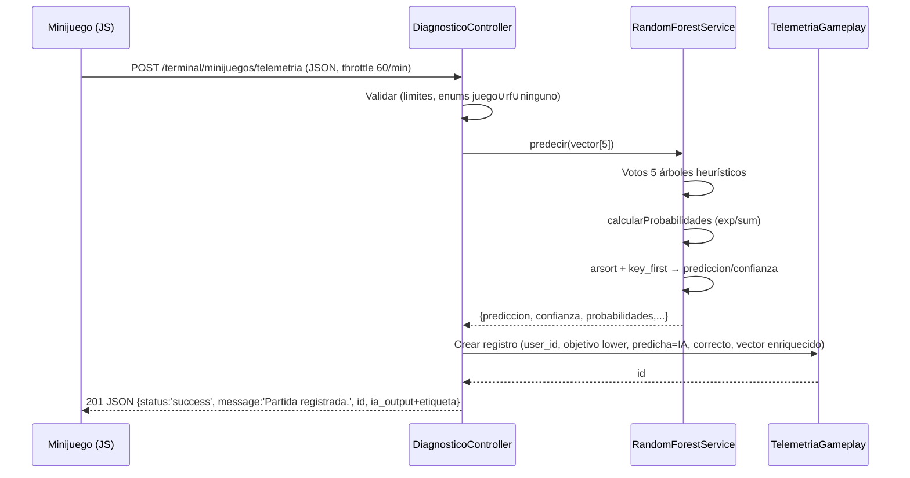
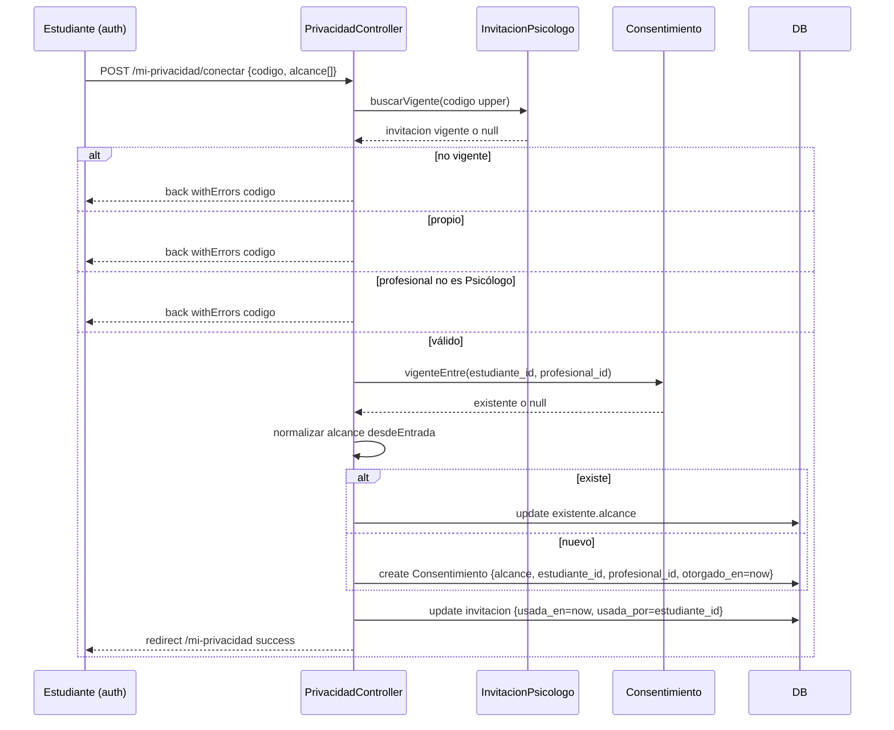
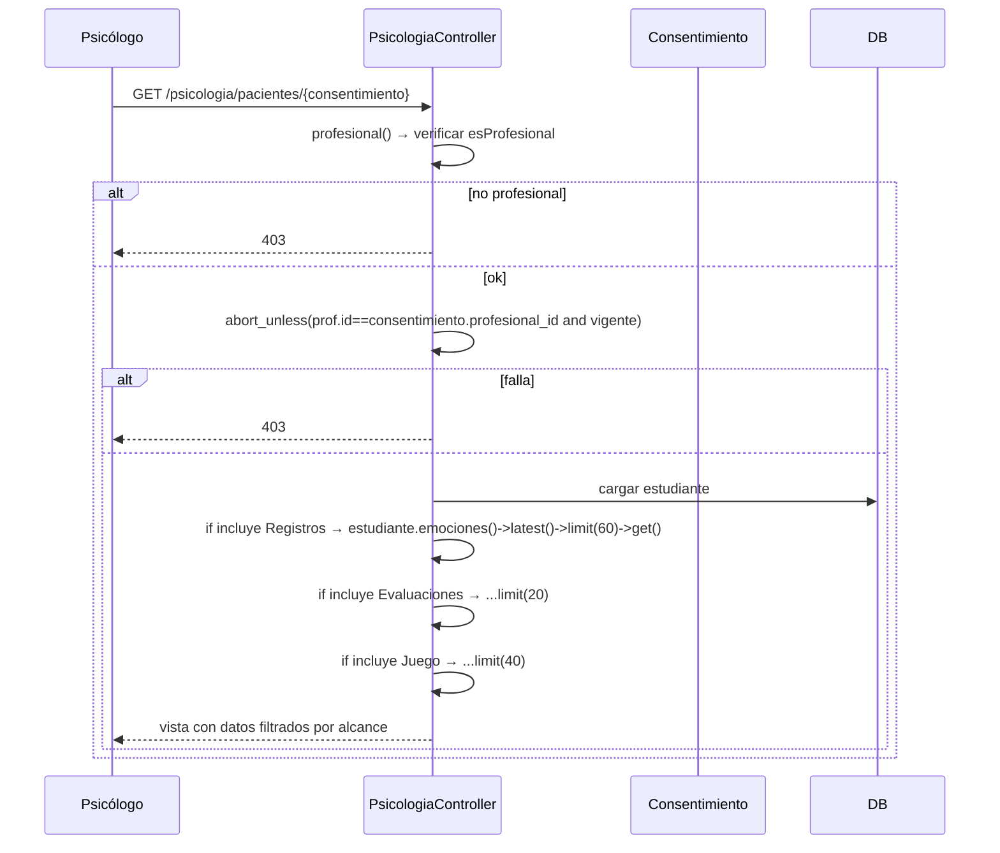
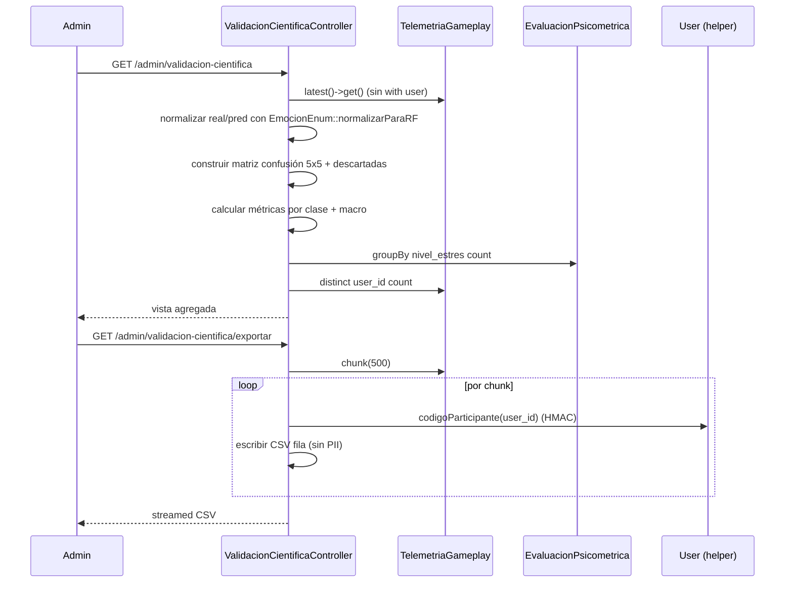

---

## Módulo: Minijuego, Telemetría e Inferencia IA

### 1. QUÉ HACE (Perspectiva Funcional)

**Propósito general:** Ejecuta el minijuego "Código Anómalo", recolecta telemetría conductual durante la partida y realiza inferencia con Random Forest heurístico para obtener predicción de emoción + confianza + probabilidades, guardando todo en `telemetria_gameplay`.

**Funcionalidades principales:**
- `index()` (GET `/terminal/minijuegos`): listado minijuegos.
- `diagnostico()` (GET `/terminal/minijuegos/diagnostico`): vista del minijuego.
- `guardarTelemetria(Request)` (POST `/terminal/minijuegos/telemetria`, throttle 60/min): valida métricas, ejecuta inferencia RF, guarda registro con vector enriquecido, retorna JSON 201.

**Reglas de negocio:**
- Topes numéricos amplios (intencionalmente no restrictivos): `latencia_promedio_ms` 0-120000 (incluye reflexión prolongada), `frecuencia_tapping` 0-30, `tiempo_total_ms` 0-300000, `conteo_rectificaciones`/`errores_diagnostico` 0-1000, `score_final` 0-100. Guardas anti-corrupción, no reglas de negocio.
- `emocion_objetivo` debe estar en `EmocionEnum::juego()` (8 clases).
- `emocion_predicha` acepta `juego() ∪ rf() ∪ ['ninguno']` (`ninguno` cuando reloj agota sin elegir).
- `diagnostico_correcto` boolean.
- `vector_caracteristicas` array size 5 con elementos validados.
- Al guardar: `emocion_objetivo` normalizado a minúsculas; `emocion_predicha` = resultado IA (`prediccion`); `diagnostico_correcto` = comparación con objetivo normalizado.
- Vector enriquecido con `confianza_ia`, `probabilidades`, `seleccion_operador`.
- Respuesta JSON 201 con `status`, `message` ('Partida registrada.'), `id`, `ia_output` (incluye `etiqueta` vía `EmocionEnum::etiqueta`).

### 2. CÓMO LO HACE (Perspectiva Técnica)

**Archivos clave:**
- `app/Http/Controllers/DiagnosticoController.php` (`__construct(RandomForestService)`, `index`, `diagnostico`, `guardarTelemetria`)
- `app/Services/RandomForestService.php` (`predecir(array $vector)`, `calcularProbabilidades(array $votos)`)
- `app/Models/TelemetriaGameplay.php` (`$table='telemetria_gameplay'`, `$fillable` con campos, casts: vector_caracteristicas array, bool correcto, decimals/ints)
- `app/Enums/EmocionEnum.php` (`juego()`, `rf()`, `etiqueta()`)

**Flujo `guardarTelemetria`:**
1. Obtener clases: `$juegoClases = EmocionEnum::juego(); $rfClases = EmocionEnum::rf();`
2. Validación con `Rule::in` y límites numéricos detallados.
3. `$analisisIA = $this->rfService->predecir($validated['vector_caracteristicas']);`
4. Crear `TelemetriaGameplay`, `fill()` con métricas + objetivo normalizado (`strtolower`), predicha = `$analisisIA['prediccion']`, correcto = (`prediccion === strtolower(objetivo)`), `vector_caracteristicas` = merge(validado vector, confianza_ia, probabilidades, seleccion_operador).
5. `$registro->user_id = Auth::id(); $registro->save();`
6. Respuesta 201 JSON con `ia_output` + `etiqueta`.

**RandomForestService::predecir($vector [latencia, tapping, tiempo, rectificaciones, score]):**
- Extrae valores con defaults: latencia=1200, tapping=1.0, tiempoTotal=30000, rectificaciones=2, score=100.
- Inicializa `$votos` con 5 clases RF: `alegria,tristeza,ansiedad,frustracion,neutralidad` → 0.0.
- Árbol 1: if tapping>=1.8 → voto ansiedad (latencia<1000) else frustracion (+1.5); elseif tapping<=0.6 → tristeza (+1.5); else neutralidad (+1.0).
- Árbol 2: if latencia<800 → alegria (score>=80) else ansiedad (+1.5); elseif latencia>2500 → frustracion (rect>=4) else tristeza (+1.5); else neutralidad (+1.0).
- Árbol 3: if rect>=5 → frustracion (+2.0), ansiedad (+1.0); elseif rect<=1 → alegria (score>=80) else neutralidad (+1.5); else neutralidad (+1.0).
- Árbol 4: if score>=80 && tiempoTotal<=25000 → alegria (+2.0); elseif score<=40 && tiempoTotal>=40000 → frustracion (+1.5), tristeza (+1.0); elseif tiempoTotal>=45000 → ansiedad (+1.0).
- Árbol 5: if tapping>1.2 && rect>=3 → ansiedad (+1.8); elseif tapping<0.8 && latencia>2000 → tristeza (+1.8).
- `$probabilidades = calcularProbabilidades($votos)` (softmax estilo: exp(peso)/sum exp).
- `arsort` + `array_key_first` para clase predicha, `confianza = prob*100`.
- Retorna prediccion, confianza, probabilidades (redondeados), arboles_votos, vector_entrada.

**calcularProbabilidades:** para cada peso $p: $e=exp($p), acumula sumExp; luego $p_c = $e_c/sumExp (si sumExp>0 else 0.2).

**DB:** `telemetria_gameplay` (user_id FK cascade, campos numéricos + JSON `vector_caracteristicas`).

**Complejidad:** ensamble heurístico 5 árboles + softmax (exp/sum exp). Clasificación 5 clases RF. Normalización taxonómica importante para validación.

---

## Módulo: Privacidad, Consentimientos e Invitaciones

### 1. QUÉ HACE (Perspectiva Funcional)

**Propósito:** Garantiza consentimiento explícito, granular, reversible. Flujo iniciado por estudiante: canjea código de invitación (un solo uso, vigencia) y elige alcance (registros/evaluaciones/juego). Revocación inmediata con histórico auditable.

**Funcionalidades:**
- `politica()` (GET `/privacidad`, pública): muestra política privacidad.
- `index()` (GET `/mi-privacidad`, auth+estudiante): panel con consentimientos otorgados (vigentes+histórico revocados), histórico separado, opciones alcance.
- `conectar(Request)` (POST `/mi-privacidad/conectar`): canjear código + otorgar/actualizar consentimiento.
- `revocar(Request, Consentimiento)` (POST `/mi-privacidad/consentimientos/{id}/revocar`): revocar consentimiento propio.

**Reglas de negocio:**
- Política pública (debe leerse antes registro).
- Código invitación: único, legible (alfabeto sin I,O,0,1,L,S: `ABCDEFGHJKMNPQRTUVWXY2346789`, 8 chars), expira 14 días, `usada_en` nullable, `usada_por` nullable.
- Canje solo con código vigente (no usado, no expirado) vía `InvitacionPsicologo::buscarVigente($codigo)`.
- Rechazar si destinatario invitación no es `Psicólogo` (`$invitacion->profesional?->esProfesional()`).
- Alcance requerido: array min1 con valores válidos `AlcanceConsentimiento::valores()`.
- **Reconexión con mismo profesional**: si existe consentimiento vigente entre ellos → **actualiza `alcance`** (no duplica). "Lo que comparto ahora" es respuesta, no eventos.
- Al conectar exitoso: marca invitación `usada_en = now()`, `usada_por = user->id`.
- Revocación: solo propietario (`estudiante_id === user->id`), `abort_unless` 403 si otro. Set `revocado_en = now()`, guarda `motivo_revocacion` (nullable). **No borra fila** (auditable).
- `consentimientos` sin UNIQUE (estudiante_id,profesional_id) intencional (historial revocaciones).
- Scope `vigentes()` = `whereNull('revocado_en')`.

**Enums:**
- `AlcanceConsentimiento`: `Registros='registros'`, `Evaluaciones='evaluaciones'`, `Juego='juego'`. Métodos `etiqueta()`, `etiquetaCorta()`, `descripcion()`, `valores()`, `desdeEntrada(mixed)` (filtra inválidos).

### 2. CÓMO LO HACE (Perspectiva Técnica)

**Archivos clave:**
- `app/Http/Controllers/PrivacidadController.php` (`politica`, `index`, `conectar`, `revocar`)
- `app/Models/Consentimiento.php` (`$table`, `$fillable` [alcance,motivo_revocacion], casts [alcance array, dates], relations, `estaVigente()`, scopes `vigentes`, `deProfesional`, `alcances()`, `incluye()`, `revocar()`, `vigenteEntre()`)
- `app/Models/InvitacionPsicologo.php` (`$fillable` incluye codigo/expira_en/usada_en/usada_por? ver modelo; profesional_id asignado explícito; relation profesional/usadaPor; `buscarVigente($codigo)` usa `where('codigo',$upper)->whereNull('usada_en')->where('expira_en','>=',now())`)
- `app/Enums/AlcanceConsentimiento.php`

**Flujo `conectar`:**
1. Validación: codigo required|string|max16, alcance required|array|min1, alcance.* in valores.
2. `$codigo = Str::upper(trim(...))`.
3. `$invitacion = InvitacionPsicologo::buscarVigente($codigo)`. Si null → error codigo.
4. Si `$invitacion->profesional_id === $user->id` → error propio.
5. Si `$invitacion->profesional?->esProfesional()` false → error no corresponde a profesional.
6. `$existente = Consentimiento::vigenteEntre($user->id, $invitacion->profesional_id)`.
7. Normalizar alcance: `array_map(fn($c)=>$c->value, AlcanceConsentimiento::desdeEntrada(...))`.
8. Si existe → `$existente->alcance = $alcance; $existente->save();` else crear nuevo Consentimiento con estudiante_id, profesional_id, alcance, otorgado_en=now.
9. Marcar invitación usada: `$invitacion->usada_en=now(); $invitacion->usada_por=$user->id; $invitacion->save();`
10. Redirect `/mi-privacidad` con success.

**Flujo `revocar`:**
1. Validar motivo nullable|string|max500.
2. `abort_unless($consentimiento->estudiante_id === $user->id, 403)`.
3. `$consentimiento->revocar($motivo ?: null)` (set revocado_en=now(), motivo_revocacion, save).
4. Redirect con success.

**DB:** `consentimientos` (alcance JSON, otorgado_en/revocado_en/motivo, FKs estudiante/profesional, índices por profesional_id+revocado_en, estudiante_id+revocado_en). `invitaciones_psicologo` (codigo unique, expira_en, usada_en, usada_por nullable nullOnDelete, FK profesional_id).

---

## Módulo: Atención Psicológica (Espacio Psicólogo)

### 1. QUÉ HACE (Perspectiva Funcional)

**Propósito:** Espacio exclusivo para rol `Psicólogo`. Muestra pacientes con consentimiento vigente y ficha filtrada por alcance. Gestiona códigos de invitación propios.

**Funcionalidades:**
- `pacientes()` (GET `/psicologia/pacientes`): listado consentimientos vigentes del profesional con estudiante.
- `paciente(Consentimiento $consentimiento)` (GET `/psicologia/pacientes/{consentimiento}`): ficha con bloques cargados solo si autorizados.
- `invitaciones()` (GET `/psicologia/invitaciones`): lista invitaciones propias ordenadas por created_at desc con usadaPor.
- `crearInvitacion()` (POST `/psicologia/invitaciones`): genera código único + guarda.
- `revocarInvitacion(InvitacionPsicologo $invitacion)` (DELETE `/psicologia/invitaciones/{id}`): anula código no usado (propietario).

**Reglas de negocio:**
- Requiere rol `Psicólogo` (middleware `role:Psicólogo`).
- `pacientes()` filtra con `vigentes()->deProfesional($prof->id)`.
- `paciente()`: `abort_unless` profesional existe + `$consentimiento->profesional_id === $prof->id` + `$consentimiento->estaVigente()` → 403 si falla.
- Carga selectiva: registros solo si `incluye(AlcanceConsentimiento::Registros)` (limit 60 latest); evaluaciones si `Evaluaciones` (20); telemetrias si `Juego` (40). Nunca carga todo.
- `crearInvitacion()`: genera código único (loop `do/while` verifica existencia). expira_en = now()+14d.
- `revocarInvitacion()`: verifica propiedad. Si `usada_en===null` → DELETE; si ya usado → NO borra (trazabilidad).
- `invitaciones()` ordena por `created_at` desc (columna timestamps).

### 2. CÓMO LO HACE (Perspectiva Técnica)

**Archivos clave:**
- `app/Http/Controllers/PsicologiaController.php` (`profesional()`, `pacientes`, `paciente`, `crearInvitacion`, `revocarInvitacion`, `invitaciones`, `generarCodigoUnico`)

**Métodos:**
- `profesional()`: retorna Auth::user() si `esProfesional()` else null.
- `generarCodigoUnico()`: `$alfabeto = 'ABCDEFGHJKMNPQRTUVWXY2346789';` genera 8 chars con `random_int`; repite si existe (`InvitacionPsicologo::where('codigo',$codigo)->exists()`).

**Flujo `paciente`:**
1. Obtener profesional (403 si no).
2. Verificar propietario + vigente (abort_unless 403).
3. `$estudiante = $consentimiento->estudiante`.
4. Cargar colecciones condicionales por alcance.
5. Retornar vista con consentimiento, estudiante, registros, evaluaciones, telemetrias.

**DB:** usa `Consentimiento`, `InvitacionPsicologo`, relaciones user.emociones/evaluaciones/telemetrias.

---

## Módulo: Administración, Feedback y Validación Científica

### 1. QUÉ HACE (Perspectiva Funcional)

**Propósito:** Gestión administrativa (usuarios, feedback) y panel de validación científica **puramente agregado** con métricas de clasificación (matriz confusión, accuracy, precision/recall/F1 macro) y export CSV anonimizado.

**Funcionalidades:**
- Gestión usuarios/feedback (vía UsuarioController, sección admin): ver listado con proyección mínima, eliminar usuario, cambiar rol, gestionar feedback (listar/eliminar/cambiar estado).
- `index()` (GET `/admin/validacion-cientifica`): panel agregado con métricas poblacionales.
- `exportarCSV()` (GET `/admin/validacion-cientifica/exportar`): descarga dataset telemetría anonimizado.

**Reglas de negocio - Validación Científica:**
- **Sin datos clínicos individuales.** No carga `with('user')` en ningún momento. No lista participantes con nombres/correos.
- Trabaja con `TelemetriaGameplay::latest()->get()` (sin eager load user).
- Normaliza etiquetas objetivo/predicha con `EmocionEnum::normalizarParaRF()` para mapear taxonomía juego (8) → RF (5).
- Clases matriz = `EmocionEnum::validacion()` = `rf()` (5). Muestras con etiqueta no convertible → contabilizadas como `descartadas` (no inflan métricas). Muestra detalle top 10.
- Métricas: accuracy sobre `muestrasIncluidas` (no total), precision/recall/F1 por clase (TP/FP/FN), macro-averages (`clasesEvaluadas` ignora clases sin soporte).
- Distribución evaluaciones: `groupBy('nivel_estres')->pluck('total','nivel_estres')` (agregado, sin user).
- Participantes telemetría: `distinct()->count('user_id')` (conteo, sin listar).
- Export CSV: **sin cargar tabla usuarios**. Columna `ID_Anonimizado` = `User::codigoParticipante($row->user_id)` (HMAC-SHA256 con APP_KEY). StreamedResponse con chunk 500, BOM UTF-8.
- Mapa colapso expuesto (`EmocionEnum::mapaColapso()`) para transparencia UI.

**Reglas negocio - Admin usuarios:**
- Listado `usuarios` solo `id,nombre,rol,created_at`.
- Cambio rol actualiza `rol` canónico + roles Spatie.

### 2. CÓMO LO HACE (Perspectiva Técnica)

**Archivos clave:**
- `app/Http/Controllers/ValidacionCientificaController.php` (`index`, `exportarCSV`)
- `app/Http/Controllers/UsuarioController.php` (métodos admin)
- `app/Enums/EmocionEnum.php` (`validacion()=rf()`, `normalizarParaRF()`, `mapaColapso()`, `juego()`, `rf()`)
- `app/Models/User.php` (`codigoParticipante($id)`, `getCodigoAnonimoAttribute()`)
- Rutas admin con `role:Administrador`

**Flujo `index()`:**
1. `$telemetrias = TelemetriaGameplay::latest()->get()` (sin with('user')).
2. `$clases = EmocionEnum::validacion()` (5).
3. Inicializar matriz confusion 5x5 cero.
4. Iterar telemetrias: normalizar real/pred → si ambos en clases → incrementar matriz, contar acierto, sumar latencia/tapping; else añadir a `descartadas`.
5. Calcular accuracy/medias sobre `muestrasIncluidas`.
6. Para cada clase: TP = diagonal; FN = suma fila excluyendo diagonal; FP = suma columna excluyendo diagonal. Calcular precision/recall/F1 (evitar división por 0). Acumular macro solo si clase evaluada.
7. Agregados: `EvaluacionPsicometrica::selectRaw('nivel_estres, COUNT(*) as total')->groupBy('nivel_estres')->pluck...`
8. `$participantesTelemetria = TelemetriaGameplay::query()->distinct()->count('user_id')`.
9. Retornar vista con todas métricas + `muestrasDescartadas`, `detalleDescartadas` (top10), `mapaColapso`.

**Flujo `exportarCSV()`:**
1. Generar filename `Dataset_StartEmotion_TelemetriaIA_YYYYmmdd_His.csv`.
2. Headers CSV + BOM (`chr(0xEF).chr(0xBB).chr(0xBF)`).
3. Escribir cabecera: ID_Anonimizado, Minijuego, Latencia_Promedio_MS, Frecuencia_Tapping_Hz, Tiempo_Total_MS, Conteo_Rectificaciones, Errores_Cometidos, Puntaje_Integridad, Emocion_Objetivo_Real, Prediccion_RandomForest, Diagnostico_Correcto, Timestamp_Captura.
4. `TelemetriaGameplay::chunk(500, function($registros) use ($handle){ foreach($registros as $row){ fputcsv($handle,[ User::codigoParticipante($row->user_id), ... $row->emocion_objetivo lower, predicha lower, correcto 1/0, created_at formatted ]) } })`
5. fclose, retornar StreamedResponse.

**Código anónimo:** `User::codigoParticipante($id)`: si null → `TESVB-SIN-IDENTIFICAR`; else `$huella = hash_hmac('sha256','participante:'.$id, config('app.key')); return 'TESVB-'.strtoupper(substr($huella,0,8));` (pseudónimo, estable por id+key).

**DB:** `telemetria_gameplay`, `evaluaciones_psicometricas`. No carga `usuarios` en queries de validación/export.

---

## Módulo: Reportes (PDF y CSV)

### 1. QUÉ HACE (Perspectiva Funcional)

**Propósito:** Generación de reportes para usuario (PDF emocional) y para investigación/validación (CSV dataset anonimizado).

**Funcionalidades:**
- PDF reporte emocional: `GET /historial/reporte` → descarga PDF con historial emociones usuario.
- CSV dataset telemetría: `GET /admin/validacion-cientifica/exportar` → descarga CSV anonimizado (chunked, streamed).

**Reglas:**
- PDF solo datos propios (usuario autenticado). Usa vista `reportes.emociones`.
- CSV anonimizado con HMAC, sin nombres/correos, incluye metadatos relevantes para validación.

### 2. CÓMO LO HACE (Perspectiva Técnica)

**Archivos clave:**
- `app/Http/Controllers/EmocionController@generarPDF()` usa `Barryvdh\DomPDF\Facade\Pdf`
- `app/Http/Controllers/ValidacionCientificaController@exportarCSV()` (streamed)
- Librería: `barryvdh/laravel-dompdf ^3.0`

**PDF:** carga vista `reportes.emociones` con `compact('historial','user')`, `download("Reporte_Neural_S-Emotion_{$user->nombre}.pdf")`.

**CSV:** streamed con `response()->stream()`, BOM UTF-8, chunk 500. Sin with('user').

---

## Módulo: Infraestructura, Middleware y Seguridad

### 1. QUÉ HACE (Perspectiva Funcional)

**Propósito:** Seguridad transversal, control de acceso por ruta, throttling, configuración aplicación.

**Funcionalidades:**
- Middleware personalizado `EsEstudiante`: reserva espacio autoobservación solo a quien es estudiante.
- Alias middleware Spatie + personalizado.
- Trust proxies para HTTPS detrás de proxy (Render u otros).
- Throttling rutas sensibles (login/registro/telemetría).
- Redirección por tipo cuenta, verificación coherencia login.

**Reglas de negocio:**
- Espacio autoobservación (`/dashboard`, historial, evaluación, calendario, minijuegos, `/mi-privacidad`) protegido por `estudiante` (no solo enlaces). `EsEstudiante` retorna 403 si no `esEstudiante()`.
- Rutas clínicas `role:Psicólogo`; rutas admin `role:Administrador`.
- Throttle: login 10/min, registro 20/min, telemetría 60/min.
- `trustProxies(at:'*')` en bootstrap (Render).
- Política pública accesible sin auth.

### 2. CÓMO LO HACE (Perspectiva Técnica)

**Archivos clave:**
- `app/Http/Middleware/EsEstudiante.php` (`handle(Request, Closure): Response`): verifica `$user && $user->esEstudiante()` else abort(403)
- `bootstrap/app.php`: `withMiddleware` registra aliases `role`, `permission`, `role_or_permission`, `estudiante => EsEstudiante::class`; `trustProxies('*')`
- `routes/web.php`: aplica `middleware(['auth'])` grupo global, subgrupo `middleware(['estudiante'])`, grupos `role:Psicólogo`, `role:Administrador`, throttling específico
- `config/auth.php`: `admin_master_key` env
- `lang/es/validation.php`: mensajes ES completos

**Justificación `EsEstudiante`:** usa `User::esEstudiante()` (combina columna `rol` + Spatie) para funcionar con tests/factories. No usa solo `role:estudiante` Spatie.

**Rutas throttling:** `Route::post('/login', ...)->middleware('throttle:10,1');` `POST /registrar` throttle 20,1; `POST /terminal/minijuegos/telemetria` throttle 60,1.